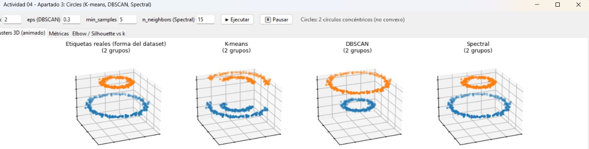
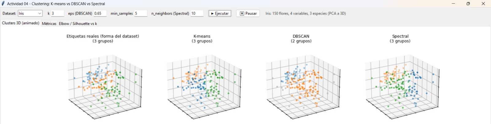

# Evaluación de algoritmos de clustering: K-means, DBSCAN y SpectralClustering

**Curso:** Minería de Datos / Aprendizaje no supervisado · EPIS – UNA Puno
**Fecha de presentación:** miércoles 11 de noviembre de 2026

**Integrantes del equipo**

| N.º | Apellidos y nombres |
|---|---|
| 1 | Turpo Quispe Patty Milagros |
| 2 | Huanca Chahuara Cyntia Mariela |
| 3 | Carrazco Yupanqui Edilza Luz |
| 4 | Quispe Hualla Yuri Florentino|

---

## 1. Objetivo

Comprender la naturaleza de los modelos de clustering **lineales y no lineales** y cómo se evalúan con métricas de **validación externa** (usan las etiquetas reales) e **interna** (solo usan los datos y los clústeres encontrados).

| Tipo | Métricas |
|---|---|
| Externa | Adjusted Rand Index (ARI), V-measure (con homogeneidad y completitud) |
| Interna | Silhouette, Davies-Bouldin, método del codo (Elbow). Se añade Calinski-Harabasz como complemento |

## 2. Contenido del repositorio

```
.
├── Practica_Clustering_Evaluacion.ipynb   # Notebook completo, con salidas ya ejecutadas
├── Informe_Clustering.pdf                 # Informe entregado en el aula virtual
├── README.md
├── app/                                   # Aplicación gráfica (Tkinter + Matplotlib)
│   ├── clustering_app.py
│   └── requirements.txt
├── capturas/                              # Capturas de pantalla de la aplicación
│   ├── app_circles.png
│   └── app_iris.png
├── figuras/                               # Gráficos generados por el notebook
│   ├── iris_modelos.png, moons_modelos.png, circles_modelos.png
│   ├── elbow_*.png, kdist_*.png
│   ├── sens_dbscan_eps.png
│   └── resumen_heatmap.png
└── resultados/                            # Tablas de métricas en CSV
    ├── metricas_iris.csv, metricas_moons.csv, metricas_circles.csv
    └── resumen_metricas.csv
```

## 3. Cómo ejecutarlo

**Opción A: Google Colab (recomendada).** Abrir el notebook y elegir *Entorno de ejecución → Ejecutar todo*. No requiere instalar nada: scikit-learn, pandas y matplotlib ya vienen incluidos.

**Opción B: local.**

```bash
pip install numpy pandas matplotlib scikit-learn jupyter
jupyter notebook Practica_Clustering_Evaluacion.ipynb
```

Al ejecutarlo se crean las carpetas `figuras/` y `resultados/`. Los resultados son reproducibles (`random_state=42`); pueden variar levemente según la versión de scikit-learn (se usó la 1.9.1).

## 4. Datasets y modelos

| Dataset | Descripción |
|---|---|
| **Iris** | 150 flores, 4 variables, 3 especies. Estandarizado con `StandardScaler`; PCA solo para graficar |
| **Moons** | `make_moons`, 500 puntos, `noise=0.07`: dos medias lunas entrelazadas |
| **Circles** | `make_circles`, 500 puntos, `factor=0.4`, `noise=0.05`: dos círculos concéntricos |

| Modelo | Naturaleza | Hiperparámetros críticos |
|---|---|---|
| **K-means** | Lineal (fronteras rectas, clústeres convexos) | `n_clusters`, `n_init`/`init`, escalado |
| **DBSCAN** | No lineal (densidad) | `eps`, `min_samples` |
| **SpectralClustering** | No lineal (grafo de afinidad) | `n_clusters`, `affinity`, `n_neighbors` o `gamma` |

Configuración usada: K-means (`k` = 3, 2, 2); DBSCAN (`eps` = 0.6, 0.2, 0.15 con `min_samples=5`); Spectral (`affinity="nearest_neighbors"`, `n_neighbors=10`).

## 5. Resultados principales

| Dataset | Modelo | Clústeres | % ruido | ARI | V-measure | Silhouette | Davies-Bouldin |
|---|---|---|---|---|---|---|---|
| Iris | K-means | 3 | 0.0 | 0.620 | 0.659 | 0.460 | 0.834 |
| Iris | DBSCAN | 2 | 17.3 | 0.471 | 0.541 | 0.642 | 0.512 |
| Iris | Spectral | 3 | 0.0 | 0.646 | 0.684 | 0.459 | 0.822 |
| Moons | K-means | 2 | 0.0 | 0.261 | 0.198 | 0.487 | 0.785 |
| Moons | DBSCAN | 2 | 0.0 | 1.000 | 1.000 | 0.332 | 1.153 |
| Moons | Spectral | 2 | 0.0 | 1.000 | 1.000 | 0.332 | 1.153 |
| Circles | K-means | 2 | 0.0 | -0.002 | 0.000 | 0.330 | 1.221 |
| Circles | DBSCAN | 2 | 0.0 | 1.000 | 1.000 | 0.157 | 205.776 |
| Circles | Spectral | 2 | 0.0 | 1.000 | 1.000 | 0.157 | 205.776 |

## 6. Aplicación gráfica interactiva (Tkinter + Matplotlib)

Además del notebook, la carpeta `app/` incluye una aplicación de escritorio que entrena **K-means, DBSCAN y SpectralClustering** sobre el dataset **Circles**, permite cambiar los hiperparámetros en vivo y muestra los clústeres, las métricas y el codo al instante. Es útil para la exposición: se ve cómo cada modelo separa (o mezcla) los dos anillos.



### Cómo ejecutarla

```bash
cd app
pip install -r requirements.txt
python clustering_app.py
```

Tkinter viene incluido con Python en Windows y macOS. En Linux puede requerir `sudo apt install python3-tk`. También se puede abrir `clustering_app.py` directamente en PyCharm.

### Qué muestra

| Pestaña | Contenido |
|---|---|
| **Clusters 3D (animado)** | 4 paneles (etiquetas reales, K-means, DBSCAN, Spectral). Primero los grupos se elevan a distinta altura en z para distinguirlos y luego la vista rota 360°. El ruido de DBSCAN se ve en gris |
| **Métricas** | Tabla con clústeres, ruido, ARI, V-measure, Silhouette y Davies-Bouldin, más una explicación de cada métrica |
| **Elbow / Silhouette vs k** | Método del codo e índice Silhouette de K-means para k = 2 a 8 |

**Controles (barra superior):** `k` (K-means y Spectral), `eps` y `min_samples` (DBSCAN), `n_neighbors` (Spectral), botón **Ejecutar** (reentrena) y botón **Pausar**. Si un valor es inválido, la app muestra un mensaje de error sin cerrarse.

### Arquitectura del código

| Capa | Clase / función | Responsabilidad |
|---|---|---|
| 1. Configuración | Constantes | Semilla 42, 400 puntos, `noise=0.05`, `factor=0.5`, colores y valores por defecto |
| 2. Datos | `DatasetRepository` | Genera Circles y lo escala con `StandardScaler` |
| 3. Modelos | `ModelRunner` | `fit_all` entrena los tres modelos; `elbow` calcula inercia y Silhouette |
| 4. Métricas | `Metrics` | ARI y V-measure (externas); Silhouette y Davies-Bouldin (internas, sin el ruido) |
| 5. Interfaz | `App` | Controles, pestañas, tabla de métricas, codo y animación 3D |

### Resultados con los parámetros por defecto (k = 2, eps = 0.3, min_samples = 5, n_neighbors = 15)

| Modelo | Clústeres | Ruido | ARI | V-measure | Silhouette | Davies-Bouldin |
|---|---|---|---|---|---|---|
| K-means | 2 | 0 | -0.002 | 0.000 | 0.354 | 1.176 |
| DBSCAN | 2 | 0 | 1.000 | 1.000 | 0.111 | 331.956 |
| Spectral | 2 | 0 | 1.000 | 1.000 | 0.111 | 331.956 |

> Los valores internos difieren de los del notebook (Silhouette 0.157 y Davies-Bouldin 205.776) porque la app usa otra configuración del dataset (400 puntos, `factor=0.5`, datos escalados). Como los centroides de ambos anillos casi coinciden, el Davies-Bouldin divide por una distancia cercana a cero y su magnitud varía mucho sin que signifique que un resultado sea mejor que otro.

### Sensibilidad que se puede comprobar en la app

- **DBSCAN, `eps`:** con 0.1 hay 17 clústeres y 254 puntos de ruido (ARI 0.195); con 0.2, 10 clústeres (ARI 0.579); entre **0.25 y 0.45** recupera los dos anillos (ARI = 1); desde 0.5 los fusiona en uno (ARI = 0).
- **Spectral, `n_neighbors`:** con 5, 10 o 15 acierta; con 3 el grafo se fragmenta y con 30 o más conecta los dos anillos (ARI ≈ 0 en ambos casos).
- **K-means, `k`:** la inercia baja sin un codo claro (505 → 306 → 214 → 169 …) y el Silhouette alcanza su máximo en k = 3 (0.389), aunque las clases reales son 2. Ni el codo ni el Silhouette sirven para elegir k en formas no convexas.

### Notas técnicas

- La animación 3D usa el atributo interno `_offsets3d` de Matplotlib (no documentado), que podría cambiar en versiones futuras. El `requirements.txt` no fija versiones; para reproducir los resultados conviene usar las mismas que el notebook (scikit-learn 1.9.1).
- La captura `capturas/app_iris.png` corresponde a una versión ampliada de la app con selector de dataset (aquí con Iris, k = 3, eps = 0.65, n_neighbors = 10). El archivo `clustering_app.py` incluido trabaja solo con Circles.
- La app complementa al notebook pero no lo reemplaza: las tablas, el barrido de `eps` y las figuras del informe provienen del notebook.



## 7. Conclusiones

1. **No hay un algoritmo mejor universal.** K-means basta para grupos compactos (Iris); para formas curvas o anidadas (Moons, Circles) se necesitan métodos de densidad o de grafos (DBSCAN, Spectral).
2. **Las métricas internas pueden engañar.** En Moons y Circles el modelo equivocado (K-means) obtiene el mejor Silhouette; en Iris, DBSCAN tiene las mejores internas y el peor ARI. Hay que combinar métricas externas, internas e inspección visual.
3. **Los hiperparámetros críticos** (`eps`, `gamma`/`n_neighbors`, `k`, `n_init`) pueden llevar el ARI de ≈ 0 a 1.

El análisis detallado de cada caso está en `Inform_Clustering.pdf` y en las secciones 1.3 a 4.1 del notebook.

